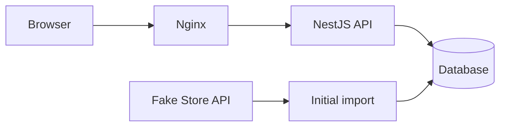

# Home Furniture App

A product explorer for the IKEA Fullstack Developer Technical Challenge, with search, category filters, pagination and product details.

A shopping cart is planned as an extra, with quantity controls, item removal, totals and persistence between visits.

The workspace structure and framework startup code are in place. Product features will follow in small, verifiable contributions.

## Prerequisites

- Git.
- Docker Desktop.
- Node.js 22 and npm 11 for local development.

## Setup

Clone the repository, open its root directory and install the local workspaces:

```sh
npm ci
```

Start each application in a separate terminal:

```sh
npm run dev:frontend
npm run dev:backend
```

The frontend runs at [localhost:3000](http://localhost:3000). The backend responds at [localhost:3001/api](http://localhost:3001/api). Only the startup screen and API root are available at this stage.

Check all three workspaces with `npm run typecheck`. Build both applications with `npm run build`. The frontend exports static files to `frontend/out`; the backend compiles to `backend/dist`.

The command below is the target Docker setup, not a working command at this stage:

```sh
docker-compose up
```

Compose will start the frontend, backend and database. A safe `.env.example` and database initialization instructions will accompany the implementation.

## Architecture

The monorepo uses npm workspaces. Both applications use strict TypeScript:

```text
frontend/           Next.js, React Router and Redux Toolkit
backend/            NestJS and TypeORM
packages/contracts/ Shared catalogue API types used by frontend and backend
```

The shared contracts package reduces duplicate type definitions and keeps the API contract consistent. It exports `Product`, `Category`, `ProductsQuery`, `ProductsResponse` and `ApiError`, with no framework dependencies or runtime code. Both applications declare it as a local workspace dependency.

`Category` is a string, and `Product` preserves the source fields, including numeric prices and ratings. `ProductsQuery` supports search, category, page, limit, sort and order. `ProductsResponse` contains items and pagination metadata. These are compile-time contracts; positive IDs, quantity limits and external data still require runtime validation.

`CartItem` lives in the frontend and contains a product and its quantity. Database entities, Fake Store import types and runtime validation DTOs will remain in the backend.

Next.js with a static export is the best fit for the selected stack. React Router will handle `/products`, `/product/:id` and `/cart`, while Nginx will serve the application.

RTK Query will cache catalogue requests. Search, filters and pagination will live in the URL to preserve the current view when navigating back.

A Redux slice will manage the cart and persist it in `localStorage`.

The frontend image will use a multi-stage build: Node.js compiles the application, and Nginx serves the static files, supports direct navigation to client routes and forwards `/api` requests to NestJS.



Fake Store API supplies the initial catalogue. The backend will validate and store imported products, then serve them from the local database through a Controller → Service → Repository structure. The frontend will request catalogue data exclusively from this backend, which will operate independently of Fake Store API after import.

Planned endpoints:

- `GET /api/products`: search, category, sorting and pagination.
- `GET /api/products/categories`: available categories.
- `GET /api/products/:id`: product details, with a 404 for missing products.

The API will include input validation, consistent error responses and Swagger documentation.

## Open decisions and delivery

The database choice and seed strategy remain open. PostgreSQL is proposed. Import requirements include reproducibility, duplicate prevention and preservation of existing data on failure.

Development will progress through setup, persistence, import, API, catalogue, details, cart and Docker integration. Each contribution will include relevant verification and documentation. Delivery will include responsive and accessible interactions, automated coverage of a frontend flow and a backend rule, and a clean-clone setup check.

See [AI_USAGE.md](AI_USAGE.md) for how AI has supported the work so far.
