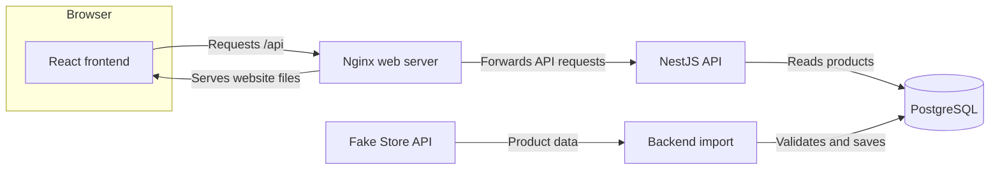

# Home Furniture App

A small product catalogue built for the IKEA Fullstack Developer Technical Challenge. You can search and filter products, open their details, and save items in a shopping cart.

The interface is in Spanish. Product information comes from Fake Store API and keeps its original language. Prices are displayed in USD. The cart is a demo: it does not include checkout or payments.

## What you can do

- Search product titles and descriptions, filter by category, and sort or move between pages.
- Open a product from the catalogue and return to the same filters and page. A directly opened product link returns to the unfiltered catalogue.
- Add products to the cart, change quantities from 1 to 100 per product, and remove items.
- Reload the page and keep your cart in the same browser profile and website origin (protocol, host, and port), when browser storage is available. The local and Docker websites have separate carts.
- Use the app on desktop or mobile, including keyboard navigation and visible focus indicators.

## Run the app with Docker

### 1. Prepare your environment

Install Git and Docker Desktop with Compose v2, and make sure Docker Desktop is running. Internet access is needed to download container images and dependencies and import the initial catalogue. Node.js is only needed if you want to develop locally or run the npm test commands.

Clone this repository and open a terminal in its root folder: the folder containing `package.json` and `compose.yaml`. All commands below run from that folder.

On first setup, copy `.env.example` to `.env`:

**Windows PowerShell**

```powershell
Copy-Item .env.example .env
```

**macOS or Linux**

```sh
cp .env.example .env
```

Keep an existing `.env` if you have already configured the app. The example values are for local development; do not use these credentials for a public deployment or commit your `.env`.

### 2. Start the complete application

```sh
docker compose up --build
```

Docker builds and starts the website, backend API, and database. You do not need to install npm packages on your computer for this step. Without --build, Docker may reuse existing images that contain an older version of the code.

### 3. Open the catalogue

Go to [http://localhost:8080/products](http://localhost:8080/products). You can also open [the cart](http://localhost:8080/cart) or [the interactive API documentation](http://localhost:8080/api/docs).

The Docker backend applies pending database migrations before starting the API. At every backend startup, including when products are already saved, it imports products in the background. Until the first successful import, product endpoints return `503` and the catalogue shows a temporary-unavailability message. Any failed startup import is retried 60 seconds after the failure, until one succeeds. Saved catalogue data remains available during upstream outages as long as the backend and database are available; product images still depend on their external hosts.

The frontend and backend Docker health checks request `/api`, which returns a static API name without querying PostgreSQL. The database service has its own `pg_isready` check, but none of these checks confirms that products exist or that catalogue queries succeed.

### Common commands

| Task | Command |
| --- | --- |
| Start in the background and wait for service health checks | `docker compose up -d --build --wait` |
| Check service status | `docker compose ps` |
| Read backend logs, including import failures | `docker compose logs backend` |
| Refresh the stored catalogue manually | `docker compose exec backend node dist/seed.js` |
| Stop and remove the application containers | `docker compose down` |

`docker compose down` keeps the database volume, so saved products survive the next startup. The cart is stored separately in your browser. Run the startup command with `--build` after changing source files.

## Configuration

The root `.env.example` lists the database settings. Copying it gives you these local defaults:

| Variable | Meaning | Example value |
| --- | --- | --- |
| `DB_HOST` | Database address for a backend running on your computer | `localhost` |
| `DB_PORT` | Database port exposed on your computer | `15432` |
| `DB_NAME` | Database name | `home_furniture` |
| `DB_USER` | Database username | `home_furniture` |
| `DB_PASSWORD` | Database password | `local_development_only` |

Docker connects the backend to `db:5432` internally. Keep the host values above for local development; Compose overrides the backend's host and port inside Docker. The database is bound to `127.0.0.1` at the configured `DB_PORT` (default `15432`), and the Docker backend has no separate public port. The website is also bound to loopback, at `127.0.0.1:8080`.

Database credentials are created when the database volume is first initialized. Editing `.env` later does not change credentials already stored in that volume. Settings supplied by your shell take precedence over `.env` when running the backend locally.

## Develop locally

Use Node.js 22 and npm 11. Prepare `.env` as described above, then install dependencies:

```sh
npm ci
```

If the full Docker app is running, stop its frontend and backend before starting local versions:

```sh
docker compose stop frontend backend
```

Start the database and apply the database migrations, which create or update its tables:

```sh
docker compose up -d --wait db
npm run migration:run
```

Keep each application running in its own terminal:

| Terminal | Command | Address |
| --- | --- | --- |
| Backend | `npm run dev:backend` | [API documentation](http://localhost:3001/api/docs) |
| Frontend | `npm run dev:frontend` | [Catalogue](http://localhost:3000/products) |

The backend imports products automatically. To refresh them manually, run `npm run seed` in another terminal. This command makes one import attempt and exits with an error if it fails.

The local frontend forwards `/api` requests to the backend on port `3001`. This keeps the browser's API requests on the same address as the website.

## Tests and builds

Install dependencies with `npm ci` before running these commands. Use Node.js 22 and npm 11.

| Command | What it checks | Requires |
| --- | --- | --- |
| `npm run lint` | ESLint rules for application code, configuration, and tests | Installed dependencies |
| `npm run typecheck` | TypeScript errors in all three workspaces | Installed dependencies |
| `npm test` | Backend configuration and import rules; cart quantities, money calculations, and saved-data validation | Installed dependencies; no running database |
| `npm run test:e2e --workspace @home-furniture/frontend` | Catalogue, details, cart, and accessibility flows in desktop and mobile Chromium | Installed Chromium; no backend |
| `npm run test:integration --workspace @home-furniture/backend` | Database migrations, constraints, import behaviour, API responses, and startup | Running PostgreSQL, configured `.env`, and applied migrations |
| `npm run test:docker` | Website routes, JavaScript files, API forwarding, and error responses | Running Docker app and Node.js |
| `npm run test:docker:restart` | API forwarding recovers when the backend becomes available after a failed DNS lookup | Docker app built and started; Node.js |
| `npm run build` | Production builds of the frontend and backend | Installed dependencies |

Install the browser once before running the browser tests:

```sh
npx playwright install chromium
```

The browser tests start the development frontend if needed and use controlled API responses. They do not verify the complete Docker deployment.

Database storage tests use temporary schemas and clean them up; the startup integration test connects using the configured database settings. Import integration tests mock Fake Store API responses, so they do not verify live upstream availability or compatibility.

The Docker recovery test uses a minimal HTTP server in the backend image to check Nginx DNS recovery; it does not run NestJS or test database recovery. It creates temporary containers and a network, then removes them without changing the application database. `DOCKER_BASE_URL` can point the Docker smoke tests at another address; the default is `http://localhost:8080`.

Build output goes to `frontend/out` and `backend/dist`. Test commands can be run separately; `npm test` does not run browser, database integration, or Docker tests.

GitHub Actions runs [the CI workflow](.github/workflows/ci.yml) on every push and pull request, and can also be started manually from the Actions tab. It checks lint, TypeScript, unit tests, PostgreSQL integration tests, production builds, and all desktop/mobile Chromium browser cases. Each run uses a temporary PostgreSQL service with test-only credentials, so no repository secrets are required. Failed browser tests upload their HTML report and traces for seven days. Docker deployment checks remain separate commands.

## How the app works

The browser uses our backend API to read products saved in PostgreSQL. Catalogue JSON from Fake Store API is fetched only by the backend's import process. Product image URLs are stored as supplied by the source, and the browser loads those images directly; the app does not download or proxy them.



Next.js builds a static export of a client-rendered React app. React Router handles navigation, and product content loads after JavaScript starts; it is absent from the initial HTML. Nginx serves the website and forwards API requests in Docker, with an HTML fallback for direct client routes. During local development, Next.js serves the website and forwards those requests instead.

| Folder | Responsibility |
| --- | --- |
| `frontend/` | React interface, React Router navigation, Redux Toolkit state, and MUI components; built with Next.js |
| `backend/` | NestJS API, input validation, product import, and database access through TypeORM |
| `packages/contracts/` | Shared TypeScript definitions for the data sent between frontend and backend |
| `scripts/` | Checks for the Docker deployment |

See [Architecture and API details](docs/architecture.md) for design decisions, caching, exact validation rules, database migrations, and import behaviour.

## API at a glance

With Docker running, the API is available under `http://localhost:8080/api`. [Swagger](http://localhost:8080/api/docs) lets you inspect the API and try requests in your browser.

| Endpoint | Returns |
| --- | --- |
| `GET /api/products` | Products, with search, category, sorting, and pagination |
| `GET /api/products/categories` | The category names available in the stored catalogue |
| `GET /api/products/:id` | One product, using its numeric ID |

For example, [this request](http://localhost:8080/api/products?sort=price&order=asc&page=1&limit=12) returns the first page sorted by price. The [API reference](docs/architecture.md#api-reference) explains all parameters and error responses.

## Assumptions and limitations

### Assumptions

- The app is a public catalogue with an anonymous demo cart. Browsing and saving products do not require an account.
- Fake Store API is the catalogue source, including its original product categories and language; imported products are not restricted to furniture.
- For this challenge, we assume the Fake Store API catalogue remains unchanged; this is a scope assumption, not an upstream guarantee. The backend nevertheless imports at every startup, even with an existing catalogue, retrying failures until success. There is no periodic synchronization after success; the manual seed command makes a separate import attempt.
- Source prices are treated as USD. The interface is in Spanish, while imported product information keeps its original language.
- The catalogue is assumed to be small enough for an in-memory import and database substring search with offset pagination; this is not a measured capacity guarantee. Compose defines one backend service, and imports have no coordination across replicas or simultaneous manual seed runs. Source product IDs are assumed to remain stable because they are the database primary keys and cart item identities.

### Limitations

- The first import needs a reachable source returning a valid, nonempty catalogue. The entire batch is validated before a transactional upsert; failed validation or writes preserve the saved catalogue. New and changed products are picked up only by a successful startup or manual import. The interface's retry buttons repeat backend reads and do not trigger an import.
- Products missing from a later import remain in the database. Imports update records by source ID; an upstream ID reused for a different product would replace that record.
- Saved catalogue data does not make the app fully offline: reads still need the backend and PostgreSQL, and product images need their external hosts. Failed images show a placeholder.
- Cart prices and other product fields are saved copies. Re-adding an existing item replaces its saved product data, including the price for all units, with the product data currently loaded in the detail page; changing quantity alone does not refresh it. There is no checkout, stock reservation, server-side cart, or automatic price synchronization.
- Cart persistence is limited to `localStorage` for one browser profile and origin; it does not follow an account or device. Invalid saved data restores an empty cart, and blocked or full storage leaves changes in memory only. Browser tabs do not synchronize their in-memory carts; the last saved change wins.
- There is no currency conversion. The home-interior banner is an original generated image for inspiration, not a representation of the imported products. Its [image and font notes](frontend/public/images/README.md) record provenance and licensing.

See [AI_USAGE.md](AI_USAGE.md) for where AI assisted development, which suggestions were accepted or changed, and how the work was verified.

## Path to production (proposed)

The starting assumption is a small public catalogue, modest traffic, one region, and one backend instance. The limitations above still apply: Fake Store API supplies the data, prices are displayed in USD, and the anonymous cart stays in the browser without checkout or stock reservation. The steps below are proposed work; the repository currently provides local Docker deployment and CI validation.

### Initial hosting and security

Reuse the frontend and backend Docker images on a managed container service, with PostgreSQL on a private network and separate staging and production databases. Preserve the single public origin: serve the static frontend and forward `/api` to the internal backend. Adapt Nginx's Docker-specific DNS resolver and upstream address to the selected hosting platform, and preserve the fallback for direct client routes.

Before public access:

- Terminate HTTPS at the hosting platform's ingress, keep the database private, and trust forwarded headers only from that ingress. Add request rate limits, size limits, and appropriate browser security headers, testing the content security policy against MUI and external product images. These controls follow the [OWASP REST security guidance](https://cheatsheetseries.owasp.org/cheatsheets/REST_Security_Cheat_Sheet.html).
- Inject production credentials through the platform's secret manager. Add verified TLS support to the TypeORM database configuration; the current connection settings do not configure it. Give the running app only the database permissions needed to read and import products, with separate credentials for schema migrations.
- Retain input validation and safe error responses, and scan dependencies and container images as part of release checks. Catalogue reads can remain public; future administrative or account operations would require authentication and authorization.

### Release and recovery

After CI passes, build container images once, tag them with the commit identifier, and deploy those exact images to staging. Run migrations as one controlled deployment step, replacing the backend image's current migration-on-startup command. Use backward-compatible schema changes so the previous application version can still run during a release.

Before promoting the same images to production, verify the complete deployment: initial import, catalogue and detail routes, cart persistence, API errors, and proxy recovery. The browser suite uses controlled API responses, so it does not cover this deployment path.

Configure automated database backups and practise restoring them into a separate database, following [PostgreSQL's backup and restore guidance](https://www.postgresql.org/docs/current/backup.html). Agree acceptable data loss and recovery time before launch. Keep the previous application images available for rollback; a schema rollback or database restore requires a separate reviewed recovery decision. One backend instance remains a single point of failure and may require a brief maintenance window for releases.

### Monitoring and operational readiness

- Centralize JSON logs with request identifiers, HTTP status, duration, and import outcomes, excluding credentials and sensitive payloads. Correlate requests across the proxy and API; [OpenTelemetry's logging model](https://opentelemetry.io/docs/concepts/signals/logs/) provides a path to add trace correlation when needed.
- Keep process liveness separate from readiness. The current `/api` health response does not query PostgreSQL or confirm that products exist. Add readiness checks for database access and an initial catalogue, and track import freshness separately so an upstream outage does not take a usable saved catalogue out of service.
- Monitor API latency and error rates, database connections and capacity, frontend failures, and the time since the last successful import. Add external checks for a real catalogue request, alerts with an owner, and short recovery instructions for database failures, stale imports, and failed releases. Set alert thresholds from staging measurements and agreed service objectives.

### Scalability and later evolution

Measure catalogue size, query times, and resource use before adding infrastructure. Start by sizing the API and database appropriately and delivering static assets through a CDN if traffic warrants it. Use query plans to guide indexes or search changes; the current substring search and offset pagination suit a small catalogue.

Before adding backend replicas, move startup imports to one scheduled worker or coordinate them with a database lock, and keep migrations outside application startup. Define an acceptable refresh interval and a policy for products removed upstream. Larger imports would also need response-size limits and batching. This ordering avoids duplicate import work while keeping the initial deployment simple.

If the scope expands to real purchases, add server-owned carts, current price and stock validation, and secure order and payment flows before accepting orders. If organic search becomes a requirement, revisit the current client-rendered product pages so product content is available in the initial HTML. Both changes introduce additional product and operational responsibilities beyond the current catalogue assumptions.
