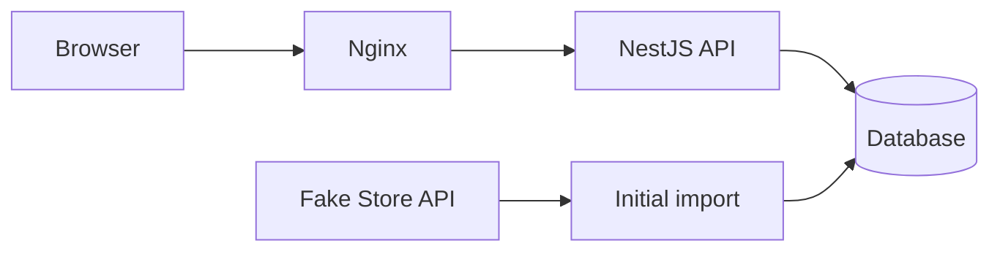

# Home Furniture App

A product explorer for the IKEA Fullstack Developer Technical Challenge, with search, category filters, pagination and product details.

Currently in the planning stage. Implementation will follow in small, verifiable contributions.

## Prerequisites

- Git.
- Docker Desktop.

## Setup

Clone the repository and open its root directory. The application has not been scaffolded yet; the command below is the target setup, not a working command at this stage:

```sh
docker compose up
```

Compose will start the frontend, backend and database. A safe `.env.example` and database initialization instructions will accompany the implementation.

## Architecture

The planned monorepo uses npm workspaces and strict TypeScript:

```text
frontend/           Next.js, React Router and Redux Toolkit
backend/            NestJS and TypeORM
packages/contracts/ Shared product, category and API types
```

Next.js with a static export is the best fit for the selected stack: React Router handles `/products` and `/product/:id`, while Nginx serves the application.

RTK Query will cache catalogue requests. Search, filters and pagination will live in the URL to preserve the current view when navigating back.

The frontend image will use a multi-stage build: Node.js compiles the application, and Nginx serves the static files, supports direct navigation to client routes and forwards `/api` requests to NestJS.



Fake Store API supplies the initial catalogue. The backend will validate and store imported products, then serve them from the local database through a Controller → Service → Repository structure. The frontend will request catalogue data exclusively from this backend, which will operate independently of Fake Store API after import.

Planned endpoints:

- `GET /api/products`: search, category, sorting and pagination.
- `GET /api/products/categories`: available categories.
- `GET /api/products/:id`: product details, with a 404 for missing products.

The API will include input validation, consistent error responses and Swagger documentation. Shared contracts will remain separate from database entities and runtime validation DTOs.

## Open decisions and delivery

The database choice and seed strategy remain open. PostgreSQL is proposed. Import requirements include reproducibility, duplicate prevention and preservation of existing data on failure.

Development will progress through setup, persistence, import, API, catalogue, details and Docker integration. Each contribution will include relevant verification and documentation. Delivery will include responsive and accessible interactions, automated coverage of a frontend flow and a backend rule, and a clean-clone setup check.

See [AI_USAGE.md](AI_USAGE.md) for how AI has supported the work so far.
