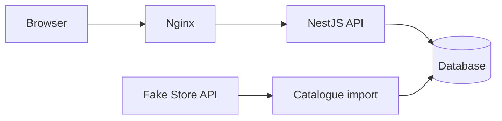

# Home Furniture App

A product explorer for the IKEA Fullstack Developer Technical Challenge, with search, category filters, pagination and product details.

A shopping cart is included as an extra, with quantity controls, item removal, exact cent totals and persistence between visits.

The catalogue, product details and cart are implemented. Docker Compose runs the complete application with Nginx, NestJS and PostgreSQL.

## Prerequisites

- Git.
- Docker Desktop.
- Node.js 22 and npm 11 only for development and host-side tests; Docker builds install their own dependencies.

## Setup

Clone the repository and open its root directory. On first setup, copy `.env.example` to `.env` and review the values. The example credentials are for local development only. Start the complete application:

```sh
docker-compose up --build
```

The application runs at [localhost:8080](http://localhost:8080). The same origin serves [products](http://localhost:8080/products), [the cart](http://localhost:8080/cart), `/product/:id`, the `/api` proxy and [Swagger](http://localhost:8080/api/docs). The backend is available only inside the Compose network; PostgreSQL retains its local development port at `localhost:15432`.

Compose waits for a healthy database. The backend image applies pending migrations before starting NestJS and exits if migrations fail. Nginx starts after the API becomes healthy. The seed runs in the background as before: a first import can briefly return catalogue `503` responses while the API itself is healthy.

`docker-compose up` also builds missing images on first startup. Use `--build` after source changes. `docker compose` is equivalent to `docker-compose`. To start in the background and wait for health checks:

```sh
docker-compose up -d --build --wait
```

Stop with `docker-compose down`; the named database volume is retained. Refresh imported products manually in Docker with `docker-compose exec backend node dist/seed.js`.

For local development, install the workspaces and start only PostgreSQL:

```sh
npm ci
docker-compose up -d --wait db
npm run migration:run
```

If the full stack is already running, stop its application containers with `docker-compose stop frontend backend` before starting a local backend. Start each local application in a separate terminal:

```sh
npm run dev:frontend
npm run dev:backend
```

The development catalogue runs at [localhost:3000/products](http://localhost:3000/products); `/` redirects there. Next.js forwards `/api` to the local backend at `localhost:3001`. Its catalogue is directly available at [localhost:3001/api/products](http://localhost:3001/api/products), with [Swagger](http://localhost:3001/api/docs) and `/api/docs-json`.

The backend imports products in the background at startup. To refresh the catalogue manually, run `npm run seed` from the root after applying migrations. This command makes one attempt, closes the database connection and exits with a nonzero status on failure. It uses the same validation and storage logic as the startup import.

Check all three workspaces with `npm run typecheck`. `npm test` runs backend configuration/import/retry tests and frontend cart reducer, cent calculation and storage validation tests. Frontend unit tests use Node.js 22's built-in TypeScript stripping without adding a test dependency. With PostgreSQL running, use `npm run test:integration --workspace @home-furniture/backend` to verify migrations, product constraints, import behaviour and startup. Storage tests use temporary schemas that are removed afterwards. Build both applications with `npm run build`. The frontend exports static files to `frontend/out`; the backend compiles to `backend/dist`.

For browser tests, install Chromium once with `npx playwright install chromium` from `frontend/`, then run `npm run test:e2e --workspace @home-furniture/frontend` from the root. Playwright starts the frontend if needed and checks desktop and mobile layouts against controlled API responses; the backend is not required for these tests.

With the Docker stack running, `npm run test:docker` verifies direct client routes, JavaScript assets, the API proxy and preserved validation errors. Set `DOCKER_BASE_URL` to test a different origin; it defaults to `http://localhost:8080`.

PostgreSQL is available at `localhost:15432`, mapped to port `5432` inside the container. Set `DB_PORT` in `.env` to change the local port. Data lives in a named Docker volume and survives container recreation and `docker-compose down`.

PostgreSQL creates the database and credentials when the volume is first initialized. Changing `.env` later does not update existing database users or passwords.

NestJS and the TypeORM CLI share connection settings from the root `.env`; existing environment variables take precedence. `DB_HOST`, `DB_PORT`, `DB_NAME`, `DB_USER` and `DB_PASSWORD` are required. Invalid settings stop startup with a configuration error. Database connections use a five-second timeout per attempt, with up to three attempts at startup.

Automatic TypeORM schema synchronization and migration execution are disabled. The Docker startup command explicitly runs the migration CLI before NestJS; local development applies migrations manually. The CLI data source is `backend/src/database/data-source.ts`, compiled to `backend/dist/database/data-source.js`. Host migration commands compile the backend first and use the same connection settings as NestJS.

- `npm run migration:show`: list applied and pending migrations.
- `npm run migration:run`: apply pending migrations transactionally; already applied migrations are skipped.
- `npm run migration:revert`: undo the last applied migration. Reverting the initial migration drops `products` and deletes its data.

The initial migration creates `products` in the default `public` schema; TypeORM records executions in `migrations`. It creates no product data. Future schema changes should use new migrations, keeping already applied migrations unchanged.

## Architecture

The monorepo uses npm workspaces. Both applications use strict TypeScript:

```text
frontend/           Next.js, React Router, Redux Toolkit and MUI
backend/            NestJS and TypeORM
packages/contracts/ Shared catalogue API types used by frontend and backend
```

The shared contracts package reduces duplicate type definitions and keeps the API contract consistent. It exports `Product`, `Category`, `ProductsQuery`, `ProductsResponse` and `ApiError`, with no framework dependencies or runtime code. Both applications declare it as a local workspace dependency.

`Category` is a string, and `Product` preserves the source fields, including numeric prices and ratings. `ProductsQuery` supports search, category, page, limit, sort and order. `ProductsResponse` contains items and pagination metadata. These are compile-time contracts; positive IDs, quantity limits and external data still require runtime validation.

`CartItem` lives in the frontend and contains a product and its quantity. Database entities, Fake Store import types and runtime validation DTOs will remain in the backend.

Next.js produces a static export. React Router handles `/products`, `/product/:id` and `/cart`, with Nginx serving the application in Docker.

RTK Query caches catalogue, category and individual product requests in the Redux store. Search, category, sorting and pagination live in the URL to preserve the current view when navigating back or reloading. Requests use the same-origin `/api` path with a ten-second timeout. Next.js provides the development proxy; Nginx provides it in Docker.

A Redux slice manages the cart. The product detail adds the selected quantity (1–100) to a new or existing line, and the header shows the total quantity. `/cart` supports quantities from 1 to 100, item removal, subtotals and a total. The selector accounts for units already in the cart, keeping the combined quantity within 100 per product. Prices are converted to integer cents before multiplication and addition; operations that would exceed JavaScript's safe integer range are rejected. Display formatting preserves those cent digits using `BigInt` and `Intl.NumberFormat.formatToParts`, including totals near the safe integer boundary. Re-adding a product refreshes its stored snapshot with the current API response.

Only cart items are persisted under `home-furniture:cart` in `localStorage`; RTK Query caches are not persisted. Restoration validates the full product shape, HTTP(S) image URLs, quantities, unique IDs and a safe cent total. Invalid stored data starts an empty cart without breaking the application. Storage errors keep the cart usable in memory; blocked or full browser storage cannot preserve new changes between visits. Quantity edits commit on blur or Enter, and invalid edits revert to the previous quantity.

The catalogue and product detail use MUI components with a consistent theme, as required by the challenge. `frontend/src/theme.ts` defines the shared palette, typography, shape, button defaults and keyboard focus indicators. `ThemeProvider` and `CssBaseline` apply it throughout the SPA. Layout CSS reads its colour variables from the same theme; `StyledEngineProvider` keeps the style order explicit.

Forms use MUI `TextField`, including native select mode for category and sorting. Buttons, product cards, read-only ratings, skeletons, alerts, typography and navigation links also use MUI. The responsive interface retains labelled controls, visible keyboard focus, reduced-motion support and accessible loading announcements. It includes retry actions, an empty-search state, unavailable-image fallbacks and independent recovery for category failures. Long imported category names wrap within product cards. Submitting a search or changing a category or sort resets pagination. Invalid URL values are normalized before requests are made.

Only results for the current query are displayed. A failed refresh can retain cached results with a visible warning, while a new filter loads its own results. Requests are refreshed after reconnecting, and cached queries older than 60 seconds are refreshed when revisited. Query caches are kept for 60 seconds after their last subscriber leaves.

The interface is in Spanish. Source product content stays in its original language. Prices are presented in USD without currency conversion as a display assumption; Fake Store does not include a currency field in the product contract.

Each catalogue card links to `/product/:id`. The detail page requests the product from the backend and displays its image, full title, category, USD price, rating and description. It provides loading skeletons, an image fallback, a distinct missing-product state and retry actions for temporary API or network failures. Invalid IDs are rejected before requesting data; valid IDs follow the API's positive 32-bit integer range. A failed refresh hides previously cached details, including when a product now returns 404.

The detail page supports keyboard navigation, focuses the main content when opened and uses a single-column layout on mobile. Returning through its catalogue link preserves the original filters and pagination in browser navigation state; opening a product directly returns to the unfiltered catalogue.

Direct product URLs and reloads work through the Next.js development server and Nginx. The static export does not enumerate product IDs; Nginx falls back to `/index.html` for client routes. Missing `/_next/` assets retain a real 404, and API errors keep their original HTTP status and JSON response.

The frontend image uses a multi-stage build: Node.js 22 compiles the application and Nginx serves only the static output. The backend image builds TypeScript separately, installs production dependencies and runs as the unprivileged Node user. `.dockerignore` restricts build contexts to source and workspace manifests, excluding local environment files, credentials, dependencies and generated output. Docker overrides database access to `db:5432`; the host `.env` retains the local development settings.



Fake Store API supplies the catalogue. The backend validates and stores imported products; catalogue requests follow Controller → Service → Repository and read only PostgreSQL. The frontend requests product data exclusively from this backend.

Available endpoints:

- `GET /api/products`: search, category, sorting and pagination.
- `GET /api/products/categories`: available categories.
- `GET /api/products/:id`: product details, with a 404 for missing products.

`GET /api/products` returns `{ items, total, page, limit, totalPages }`. Prices are numbers and ratings keep the source shape `{ rate, count }`. Categories are distinct, alphabetically ordered strings. Product details return the same product shape as catalogue items.

| Parameter | Behaviour | Default |
| --- | --- | --- |
| `search` | Literal, case-insensitive search in title and description; up to 200 characters | No search |
| `category` | Exact category name, preserved without truncation | All categories |
| `page` | Integer from 1 to 2147483647 | `1` |
| `limit` | Integer from 1 to 100 | `12` |
| `sort` | `id`, `title` or `price` | `id` |
| `order` | `asc` or `desc` | `asc` |

Search and category filters combine. Search whitespace is trimmed; empty search and category values apply no filter. `%` and `_` are literal search characters. Equal sort values are resolved by ascending ID. Pages beyond the last page return an empty list while retaining the total count; no matches return `totalPages: 0`.

Query values are validated with `class-validator` and explicitly transformed with `class-transformer`. Unknown parameters, repeated scalar values, null characters in text filters, invalid IDs and invalid pagination or sorting return `400`. IDs must be positive 32-bit integers. Missing products return `404` when a local catalogue exists; an empty catalogue returns `503` for all three product endpoints. Unexpected failures return a generic `500` without SQL or stack traces.

The global exception filter returns `{ statusCode, message, error }`; validation messages are arrays and other messages are strings. Swagger documents the query parameters, response models and error statuses.

## Storage and import

PostgreSQL 18.6 is selected, using the pinned `postgres:18.6-alpine3.24` image. The product entity, initial migration and seed are implemented.

`ProductEntity` uses the source ID as a non-generated integer primary key. All fields are required. Prices use `NUMERIC(12,2)` and remain strings inside the entity to preserve exact decimals; the API maps them to the shared numeric `Product` contract. Ratings use `rating_rate` and `rating_count` columns. Constraints reject nonpositive IDs, negative or out-of-range prices, blank titles, categories or image references, ratings outside 0–5 and negative rating counts. Text fields use `TEXT` without arbitrary length limits.

IDs and rating counts are limited to PostgreSQL's signed 32-bit integer range. Import validation checks HTTP(S) image URLs and rejects prices with more than two decimal places before writing: PostgreSQL itself rounds excess decimal places when assigning a `NUMERIC(12,2)` value. Validation uses `class-validator` and `class-transformer` without implicit type conversion; additional source fields are ignored.

- Use Fake Store IDs as product primary keys. Store prices as exact `NUMERIC(12,2)` values, rejecting negative, out-of-range or higher-precision prices rather than silently rounding them. The API keeps `price: number`; cart calculations use integer cents.
- Insert new products, update changed fields and leave identical products untouched through a transactional upsert. Preserve local products missing from a response.
- Validate the complete response, including ratings and duplicate IDs, before writing. Reject empty responses. Apply each batch in a transaction so a failed write leaves the existing catalogue intact.
- Run an import in the background at backend startup, including when local products already exist. HTTP requests have a ten-second deadline. Schedule the next attempt 60 seconds after a failure, without overlapping attempts, and stop after the first success. Shutdown cancels HTTP work and scheduled retries and waits for an active import before closing the database connection.

Migrations must complete before the API starts. An external import failure does not prevent startup and leaves stored products intact. Failures are logged without dumping upstream responses or database write details. The catalogue API serves existing products and returns `503` when no catalogue is available. The frontend shows a temporary-unavailability message with a retry button that queries our API again without triggering an external import. Searches with no matches return `200` with an empty list.

## Assumptions and limitations

- Fake Store is the only product source, and its IDs are assumed to remain stable.
- Prices have at most two decimal places. Exact database storage does not make JavaScript floating-point arithmetic exact.
- Cart prices are local snapshots, with no checkout, stock reservation, server-side cart or continuous price synchronization. A future checkout must validate current prices and availability on the backend. Browser tabs maintain separate in-memory carts and the last local storage write wins.
- Products genuinely removed upstream will remain locally. Incorrect upstream values that pass validation may replace previously correct values.
- Updates happen at startup or through a manual import, without continuous synchronization. The first successful import requires Fake Store to be available; subsequent outages can leave the local catalogue outdated.
- Import coordination assumes a single backend instance. Multiple instances would require coordination to prevent overlapping imports.
- The small source catalogue is parsed and imported in memory. Larger sources would need response-size limits and a batching strategy. Price validation operates on JSON numbers after parsing; it cannot recover precision already lost in the source's numeric representation.
- Catalogue reads use offset pagination and substring search without dedicated search indexes, which suits the small source catalogue. Text ordering and case conversion follow PostgreSQL's database collation.

## Delivery

Setup, persistence, import, API, catalogue, details, cart and Docker integration are implemented with automated verification. The remaining challenge closure is a complete accessibility review and a final installation check from a clean Git clone.

See [AI_USAGE.md](AI_USAGE.md) for how AI has supported the work so far.
