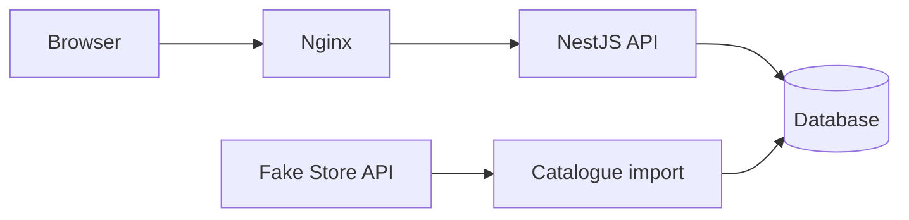

# Home Furniture App

A product explorer for the IKEA Fullstack Developer Technical Challenge, with search, category filters, pagination and product details.

A shopping cart is planned as an extra, with quantity controls, item removal, totals and persistence between visits.

The workspace structure, framework startup code and NestJS connection to PostgreSQL are in place. Product features will follow in small, verifiable contributions.

## Prerequisites

- Git.
- Docker Desktop.
- Node.js 22 and npm 11 for local development.

## Setup

Clone the repository, open its root directory and install the local workspaces:

```sh
npm ci
```

Copy `.env.example` to `.env` on first setup and review the values. The example credentials are for local development only. Start PostgreSQL before the backend:

```sh
docker-compose up
```

Compose currently starts only PostgreSQL. To start it in the background and wait until healthy, use `docker-compose up -d --wait db`.

Start each application in a separate terminal:

```sh
npm run dev:frontend
npm run dev:backend
```

The frontend runs at [localhost:3000](http://localhost:3000). The backend responds at [localhost:3001/api](http://localhost:3001/api). Only the startup screen and API root are available at this stage.

Check all three workspaces with `npm run typecheck` and run backend configuration tests with `npm test`. With PostgreSQL running, use `npm run test:integration --workspace @home-furniture/backend` to verify product storage constraints in a temporary schema, rolled back after the test. Build both applications with `npm run build`. The frontend exports static files to `frontend/out`; the backend compiles to `backend/dist`.

PostgreSQL is available at `localhost:15432`, mapped to port `5432` inside the container. Set `DB_PORT` in `.env` to change the local port. Data lives in a named Docker volume and survives container recreation and `docker-compose down`.

PostgreSQL creates the database and credentials when the volume is first initialized. Changing `.env` later does not update existing database users or passwords.

NestJS and the TypeORM CLI share connection settings from the root `.env`; existing environment variables take precedence. `DB_HOST`, `DB_PORT`, `DB_NAME`, `DB_USER` and `DB_PASSWORD` are required. Invalid settings stop startup with a configuration error. Database connections use a five-second timeout per attempt, with up to three attempts at startup.

Automatic schema synchronization and migration execution are disabled. No application tables are created yet. The CLI data source is `backend/src/database/data-source.ts`, compiled to `backend/dist/database/data-source.js`; migration commands follow in the next step.

## Architecture

The monorepo uses npm workspaces. Both applications use strict TypeScript:

```text
frontend/           Next.js, React Router and Redux Toolkit
backend/            NestJS and TypeORM
packages/contracts/ Shared catalogue API types used by frontend and backend
```

The shared contracts package reduces duplicate type definitions and keeps the API contract consistent. It exports `Product`, `Category`, `ProductsQuery`, `ProductsResponse` and `ApiError`, with no framework dependencies or runtime code. Both applications declare it as a local workspace dependency.

`Category` is a string, and `Product` preserves the source fields, including numeric prices and ratings. `ProductsQuery` supports search, category, page, limit, sort and order. `ProductsResponse` contains items and pagination metadata. These are compile-time contracts; positive IDs, quantity limits and external data still require runtime validation.

`CartItem` lives in the frontend and contains a product and its quantity. Database entities, Fake Store import types and runtime validation DTOs will remain in the backend.

Next.js with a static export is the best fit for the selected stack. React Router will handle `/products`, `/product/:id` and `/cart`, while Nginx will serve the application.

RTK Query will cache catalogue requests. Search, filters and pagination will live in the URL to preserve the current view when navigating back.

A Redux slice will manage the cart and persist it in `localStorage`.

The frontend image will use a multi-stage build: Node.js compiles the application, and Nginx serves the static files, supports direct navigation to client routes and forwards `/api` requests to NestJS.



Fake Store API supplies the initial catalogue. The backend will validate and store imported products, then serve them from the local database through a Controller → Service → Repository structure. The frontend will request catalogue data exclusively from this backend, which will operate independently of Fake Store API after import.

Planned endpoints:

- `GET /api/products`: search, category, sorting and pagination.
- `GET /api/products/categories`: available categories.
- `GET /api/products/:id`: product details, with a 404 for missing products.

The API will include input validation, consistent error responses and Swagger documentation.

## Storage and import

PostgreSQL 18.6 is selected, using the pinned `postgres:18.6-alpine3.24` image. The product entity is defined; applying its schema through a migration and implementing the import remain pending.

`ProductEntity` uses the source ID as a non-generated integer primary key. All fields are required. Prices use `NUMERIC(12,2)` and remain strings inside the entity to preserve exact decimals; API mapping to `Product` will happen separately. Ratings use `rating_rate` and `rating_count` columns. Constraints reject nonpositive IDs, negative or out-of-range prices, blank titles, categories or image references, ratings outside 0–5 and negative rating counts. Text fields use `TEXT` without arbitrary length limits.

IDs and rating counts are limited to PostgreSQL's signed 32-bit integer range. Image URL validation and rejection of prices with more than two decimal places belong to the upcoming import validation: PostgreSQL rounds excess decimal places when assigning a `NUMERIC(12,2)` value.

- Use Fake Store IDs as product primary keys. Store prices as exact `NUMERIC(12,2)` values, rejecting negative, out-of-range or higher-precision prices rather than silently rounding them. The API keeps `price: number`; cart calculations will use integer cents.
- Insert new products, update changed fields and leave identical products untouched. Preserve local products missing from a response.
- Validate the complete response, including ratings and duplicate IDs, before writing. Reject empty responses. Apply each batch in a transaction so a failed write leaves the existing catalogue intact.
- Run an import in the background at backend startup, including when local products already exist. Retry failed attempts every 60 seconds until one succeeds, then stop. A dedicated command will reuse the same import logic for manual updates.

Migrations must complete before the API starts. An external import failure will not prevent the API or frontend from starting. If local products exist, the application will continue serving them and log the failure. Without a local catalogue, the API will return `503` and the frontend will show a temporary-unavailability message with a retry button. That button queries our API again; it does not trigger an external import. Searches with no matches will return `200` with an empty list.

## Assumptions and limitations

- Fake Store is the only product source, and its IDs are assumed to remain stable.
- Prices have at most two decimal places. Exact database storage does not make JavaScript floating-point arithmetic exact.
- Products genuinely removed upstream will remain locally. Incorrect upstream values that pass validation may replace previously correct values.
- Updates happen at startup or through a manual import, without continuous synchronization. The first successful import requires Fake Store to be available; subsequent outages can leave the local catalogue outdated.
- Import coordination assumes a single backend instance. Multiple instances would require coordination to prevent overlapping imports.

## Delivery

Development will progress through setup, persistence, import, API, catalogue, details, cart and Docker integration. Each contribution will include relevant verification and documentation. Delivery will include responsive and accessible interactions, automated coverage of a frontend flow and a backend rule, and a clean-clone setup check.

See [AI_USAGE.md](AI_USAGE.md) for how AI has supported the work so far.
